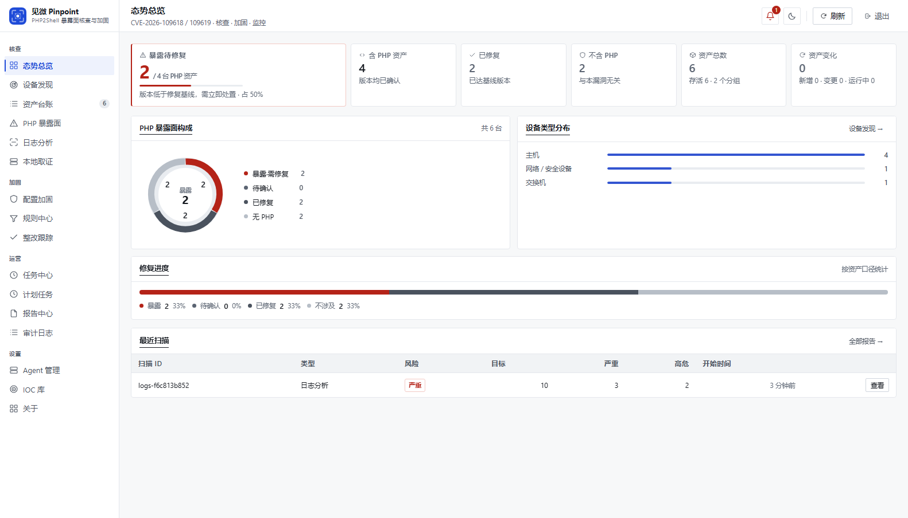
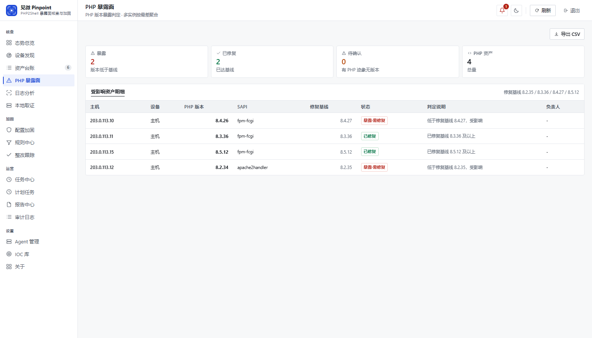
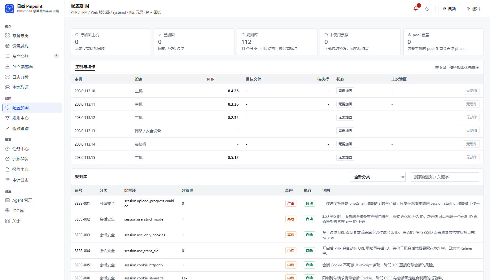
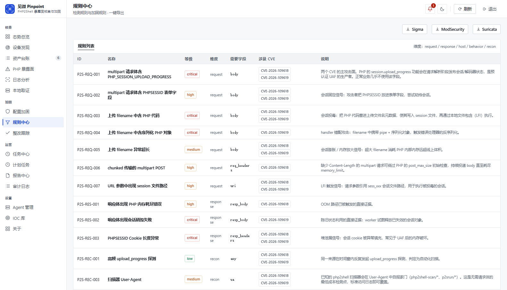

<div align="center">


# 见微 Pinpoint

**PHP2Shell 漏洞暴露面评估与加固平台**

查清内网哪些 PHP 实例真的会受 CVE-2026-109618 / CVE-2026-109619 影响，
并给出可直接执行、可回滚、可复核的处置方案。

[](LICENSE)
[](https://github.com/odin1024/jianwei-pinpoint/actions/workflows/ci.yml)
[](https://www.python.org/)
[](CHANGELOG.md)

[快速开始](#快速开始) · [核心能力](#核心能力) · [界面](#界面) · [判定口径](#判定口径) · [文档](#文档)



</div>

---

## 为什么需要它

**PHP2Shell** 针对 PHP 会话上传机制，影响面覆盖几乎所有对外提供 PHP 服务的主机。

| 项目 | 内容 |
|---|---|
| 漏洞 | CVE-2026-109618（OOM 内存破坏）、CVE-2026-109619（陈旧全局状态 UAF） |
| 严重性 | CVSS v4 **9.2**，2026-10-21 官方修复，已被 **CISA KEV** 收录（2026-10-26） |
| 修复基线 | PHP **8.5.12 / 8.4.27 / 8.3.36 / 8.2.35** |

难点从来不是"知道有这个漏洞"，而是回答三个问题：

1. 我的环境里**哪些** PHP 实例在受影响范围内？
2. 它的版本号看着是安全的，**实际**到底有没有编入修复？
3. 确认受影响之后，**怎么改**、改完怎么证明改对了？

见微把这三件事串成一条链路：发现 → 判定 → 取证 → 加固 → 复核。

---

## 核心能力

| 能力 | 说明 |
|---|---|
| **暴露面发现** | 端口 → 协议 → 存活 → 设备类型 → PHP 暴露面五层收敛；跨主机噪声端口识别，避免把 NAT / tarpit 误记成设备 |
| **版本与修复判定** | 按 PHP 分支比对修复基线，输出三档结论：确认受影响 / 无法判定 / 确认已修复 |
| **补丁标记与二进制证据** | 不只看版本号：读取运行时补丁标志与二进制构建信息，识别"版本号看着安全、实际没修"，以及反向的误报 |
| **本地取证** | 只读清点安装点、生效配置、容器与 K8s 内的 PHP、入侵痕迹与进程连接，给出主机侧确认结论 |
| **日志被动检测** | 零风险：对现有访问日志做规则匹配，发现利用尝试与扫描器行为，无需接触目标 |
| **加固规则库** | **112 条**规则，覆盖会话、信息暴露、高危特性、资源、日志、FPM、Web 服务器、系统服务、K8s、Windows / IIS 共 11 类 |
| **加固执行纪律** | 生成加固包 + 一次性票据 + 计划指纹，动作白名单，逐项回执，可回滚；平台不直连主机改配置 |
| **整改跟踪与报告** | 处置状态、责任人、复扫联动；导出 Markdown / HTML / JSON / CSV，规则导出 Sigma / ModSecurity / Suricata |

---

## 界面

**PHP 暴露面** —— 每台主机、每个实例的版本、SAPI、修复基线与判定依据，逐条可追。



**配置加固** —— 规则带风险等级与"能否自动执行"标记，生成可交付的加固包。



**规则中心** —— 检测规则与 CVE 的对应关系、所需字段与判定说明，可一键导出到现有安全设备。



> 以上截图使用界面演示数据，地址取自 RFC 5737 文档专用段（`203.0.113.0/24`），非真实资产。

---

## 快速开始

### 方式一：Docker（推荐）

```bash
git clone https://github.com/odin1024/jianwei-pinpoint.git
cd jianwei-pinpoint/app

export P2S_CONSOLE_PASSWORD='换成你自己的强口令'
docker compose up -d
# 浏览器打开 http://127.0.0.1:18080
```

默认只发布到回环地址。需要让同事访问时，把 `docker-compose.yml` 里的端口改成
`"18080:18080"`，并务必保留口令设置。

### 方式二：源码运行

```bash
git clone https://github.com/odin1024/jianwei-pinpoint.git
cd jianwei-pinpoint/app

python -m venv .venv
source .venv/bin/activate          # Windows: .venv\Scripts\activate
pip install -r requirements.lock.txt
pip install -e . --no-deps

export P2S_ADMIN_PASSWORD='换成你自己的强口令'
python -m p2s.cli serve --port 18080
```

> 没有内置默认口令。未设置时每次启动会随机生成并打印在启动日志里。

### 命令行

```bash
p2s discover --cidr 192.168.1.0/24 --report reports/   # 设备发现 + PHP 暴露面
p2s probe    --cidr 192.168.1.0/24                     # 追加无害主动探测
p2s logs     --file examples/access.log.sample         # 日志被动检测（零风险）
p2s host                                               # 本机只读取证
p2s rules    --export sigma                            # 导出规则
p2s serve                                              # Web 控制台
```

完整参数见 `p2s <子命令> --help`，或看 [检测说明](app/docs/DETECTION.md)。

---

## 判定口径

这套工具的价值不在于"扫出一个洞"，而在于**结论可信到什么程度**。因此每条判定都带证据来源：

| 结论 | 含义 | 依据 |
|---|---|---|
| **确认受影响** | 可以直接据此安排处置 | 版本低于修复基线，或二进制 / 运行时标志证明未编入修复 |
| **无法判定** | 需要补一次本地取证 | 远程只能看到线索，例如版本被隐藏、代理拦截、版本与补丁标志矛盾 |
| **确认已修复** | 可以留档结案 | 版本已达基线，且（在有条件时）补丁标志与构建信息一致 |

原则是：**远程只能提出怀疑，本地才能给出证明。**
每一处"无法判定"都是产品主动承认的能力边界，而不是含糊过去。

加固同理：**加固不等于修复**。它只降低攻击面，唯一完整的修复是把 PHP 升级到修复版本。

---

## 能力边界

| 做 | 不做 |
|---|---|
| 暴露面五层收敛、版本与补丁判定、本地取证 | 不做通用漏洞扫描器 |
| 只读检测；加固只生成包，由你在目标机执行 | 不发送利用载荷、不做打穿验证 |
| 日志被动检测与行为关联 | 不修改被检系统、不上传任何数据 |
| 报告与规则导出到现有安全设备 | 不提供托管服务、无遥测与回连 |

检测准确率有独立的基准集与可复现步骤，同时明确写出"这个基准不能证明什么"——
见 [基准集说明](docs/BENCHMARK.md)。

---

## 支持范围

| 维度 | 范围 |
|---|---|
| PHP 分支 | 8.2 · 8.3 · 8.4 · 8.5（含各发行版向后移植版本） |
| SAPI | `fpm-fcgi` · `apache2handler` · `cli-server` · `cli` |
| 运行形态 | 裸机 / 虚拟机 / Docker / Kubernetes |
| 检测端系统 | Linux · Windows（含 IIS / Windows 权限加固规则） |

细节见 [平台适配](app/docs/PLATFORMS.md)、[架构说明](app/docs/ARCHITECTURE.md)。

---

## 文档

| 文档 | 内容 |
|---|---|
| [部署说明（客户环境）](app/docs/DEPLOY-CUSTOMER.md) | 反向代理、TLS、口令、数据目录、离线安装 |
| [检测原理](app/docs/DETECTION.md) | 五层判定流程、证据分级、结论口径 |
| [架构说明](app/docs/ARCHITECTURE.md) | 模块划分与数据流 |
| [平台适配](app/docs/PLATFORMS.md) | 各发行版与 SAPI 的差异处理 |
| [基准集](docs/BENCHMARK.md) | 准确率复现步骤与判断标准 |
| [变更记录](CHANGELOG.md) | 版本演进的唯一权威来源 |
| [参与贡献](CONTRIBUTING.md) | 开发规范与门禁清单 |

---

## 授权与免责

这是一个**主动探测**工具。对非自有资产执行扫描，在很多司法辖区属于违法行为，
并可能触发对方的安全响应。

**使用前请确认：**

1. 目标资产属于你本人，或你已取得**书面授权**（含探测范围与时窗）；
2. 已告知目标系统的运维方，避免被误判为攻击而中断业务；
3. 扫描频率与并发控制在业务可承受范围内（本项目默认保守，请勿随意调高）。

**平台的设计约束（按此实现，不是口头承诺）：**

| 约束 | 实现方式 |
|---|---|
| 不主动外联 | 只连接你填写的目标，无遥测、无回连 |
| 控制台默认仅监听回环 | `serve` 默认 `127.0.0.1`，对外暴露需显式指定 |
| 加固不直连主机 | 生成加固包由你在目标机执行，平台不远程改配置 |
| 加固不等于修复 | 只降低攻击面；完整修复是升级 PHP |

本软件按"现状"提供，不附带任何明示或暗示的担保。因使用本软件造成的任何直接或间接损失
（含业务中断、数据损坏、法律纠纷），作者与贡献者不承担责任。
**使用即表示你已理解并接受上述约束。**

---

## 许可

[Apache License 2.0](LICENSE)，附带 [NOTICE](NOTICE) 说明第三方依赖与情报素材的来源与版权。

- ✅ 可商用、可修改、可闭源分发
- ✅ 含专利授权（第 3 条）
- ⚠️ 修改后的文件需保留变更说明；分发时须附上本许可
- ⚠️ 许可不授予使用本项目商标与商品名的权利（第 6 条）